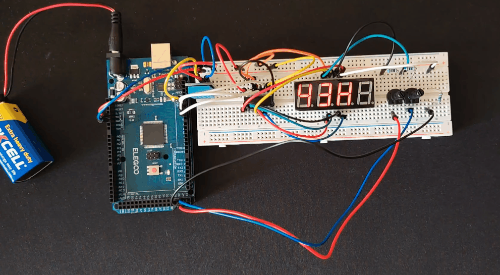

# Temperature-and-Humidity-Monitor
> **Implementation Note:** Drivers for DHT11 sensor and 74HC595 IC were written entirely from scratch by me using ATmega 2560 standard AVR libraries which are also available in my documentation. Direct register manipulation was performed using my own ATmega 2560 memory register map, [linked here](https://github.com/RaresCM/ATMega2560-Custom-Documentation).

## Overview
This is my custom designed temperature and humidity sensor. It uses a DHT11 along with a 4 digit 7 segment display and 74HC595 IC to measure and output the temperature and humidity to the 7 segment display to be read. It is configured for degrees denoted by C and relative humidity percentage denoted by H. Display brightness is controlled physically by 2 potentiometers.

## Key Features
This project was built to apply concepts from my EEE course as well as module integration and features:
* DHT11 sensor for accurate and fast temperature and humidity values to the tenths place and no decimals
* 74HC595 IC to drive the 4 digit 7 segment display
* Custom logic to read a byte from the DHT11, decode it and translate it to 7 segment digit data to be displayed
* 2 potentiometers to control the brightness of the display

## Repository Structure
- /main.c - The main code for the clock to be uploaded to the chip
- /platformio.ini - PlatformIO settings to be used with VS code and PlatformIO extension
- /designlog.md - My log of findings, learning and obstacles encountered during the design of the alarm clock
